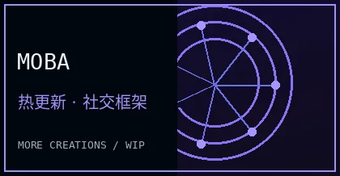
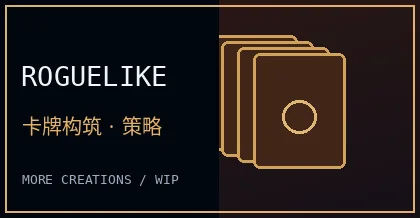

**Unity 游戏开发者 · Gameplay Programmer · Multiplayer Systems**

你好，我是 **White**。喜欢游戏，也喜欢把自己的想法变成能真正运行的作品。  
这里是我的**游戏与技术陈列室**：记录独立游戏创作、客户端开发和联机技术实践。

<a href="https://github.com/shaobaichen">GitHub</a>　·　<a href="mailto:2767955151@qq.com">2767955151@qq.com</a>

---

## 🎮 Featured Works · 我的作品陈列室

每个项目都有属于自己的世界。点进对应的作品仓库，可以了解更完整的技术实现。

### 01 · 《魇》 YAN: The Forgotten Mask

**中式民俗志怪题材 · 第三人称动作 RPG**　`Unity 6` `C#` `URP` `WIP / 开发中`

《魇》是我正在制作的独立游戏与毕业设计，灵感来自中国傩文化、传统民俗及志怪想象。当前主要推进无归村关卡、角色与场景表现、交互界面以及动作玩法原型。

展柜背景为氛围设计图；其中的主菜单、角色场景与行囊画面来自实际 Unity 开发截图，经过裁切处理。目前项目仍在持续制作中，不代表全部玩法已经完成。

📷 再看一张《魇》的开发中画面：无归村休整点

包含尚未替换的占位模型，展示的是开发过程而非最终版本。

> 《魇》目前尚未公开完整源码。后续会在这里补充独立项目展示页、实机演示与开发记录。

 

### 02 · Lockstep Arena

**1v1 帧同步局域网竞技场**　`Unity 6` `C#` `TCP` `Protobuf` `Client Prediction` `Rollback`

一个可游玩的多人联机技术项目。它将战斗规则从 Unity 表现层独立出来，由服务器发布完整权威输入帧；客户端支持有界预测、Dirty Frame 检测和状态回滚，并通过 StateDigest 与权威帧回放验证对局一致性。

  
  

左：状态诊断 / Diagnostics　·　右：权威帧回放 / Authoritative Replay。上方均为正式 Windows Player 版本的真实截图；科技展签为装饰性设计图。

**🔗 [查看 LockstepArena_Portfolio：正式源码、架构说明与运行指南 →](https://github.com/shaobaichen/LockstepArena_Portfolio)**

---

## 🗂️ More Creations · 更多创作

<table>
<tr>
<td width="33%" align="center"> <b>MOBA 客户端框架</b> Unity · xLua · 热更新 · 社交系统 资料整理中</td>
<td width="33%" align="center"> <b>Roguelike 卡牌</b> ScriptableObject · 卡牌构筑 资料整理中</td>
<td width="33%" align="center"> <b>AI 开发探索</b> Agent · 工作流 · 开发工具 持续研究中</td>
</tr>
</table>

这些项目的公开资料还在陆续整理；等仓库或演示页面准备好后，会补上可访问的链接。

## 🛠️ Tech Stack · 技术与工具

`Unity` · `C#` · `Lua / xLua` · `TCP / Protobuf` · `UGUI` · `AssetBundle` · `Git` · `C++ / LeetCode`

---

**Make games. Learn systems. Keep creating.**

📬 **[2767955151@qq.com](mailto:2767955151@qq.com)**　·　**[github.com/shaobaichen](https://github.com/shaobaichen)**

