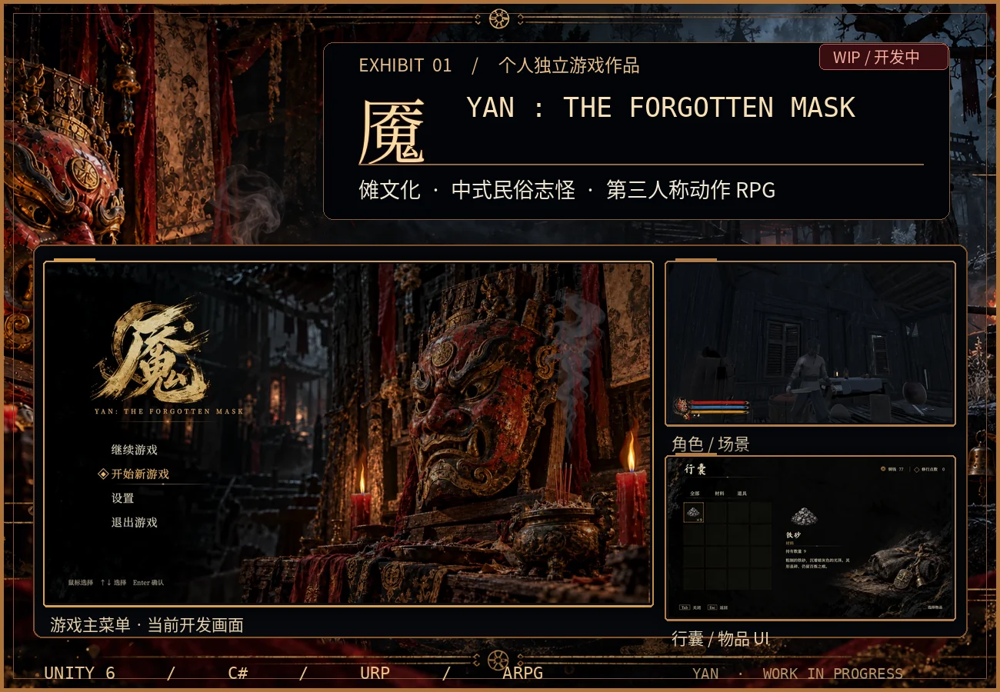
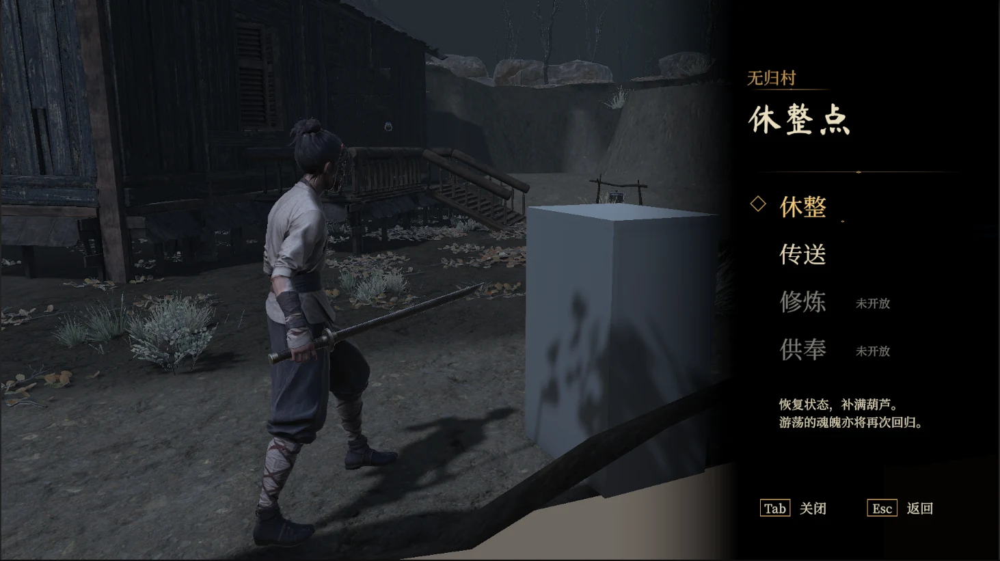
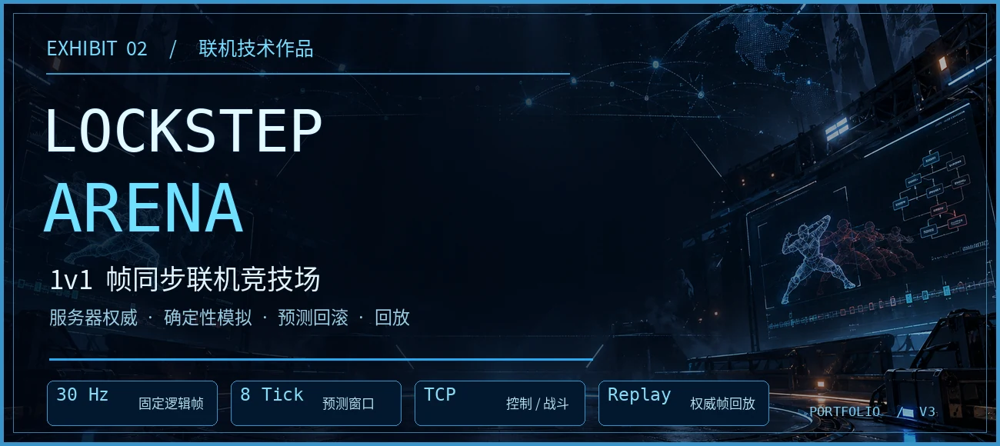
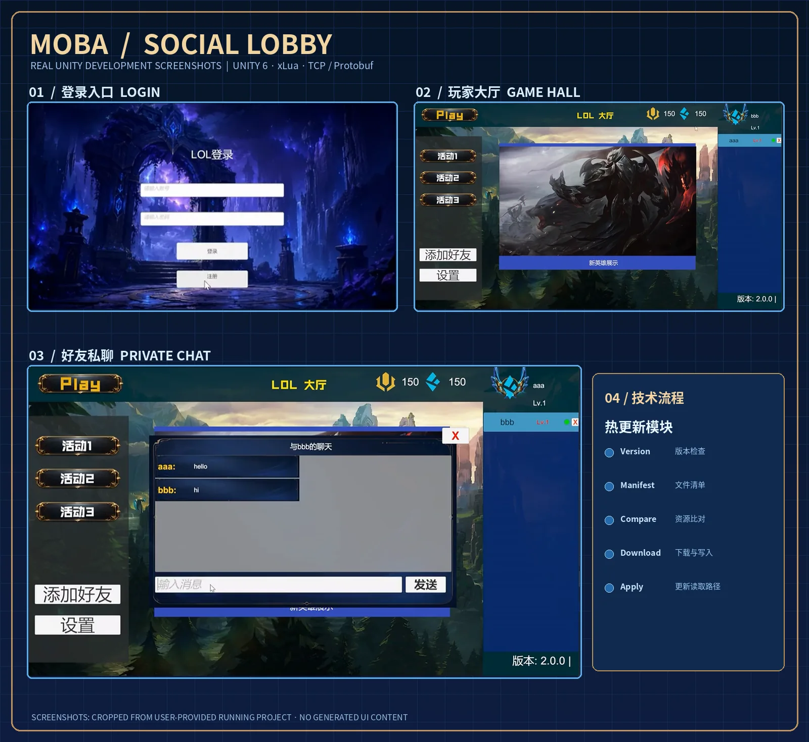
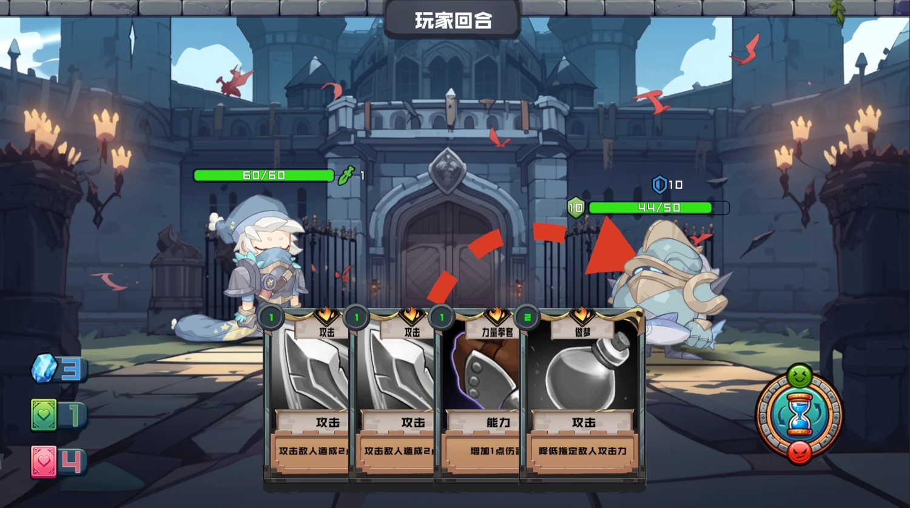
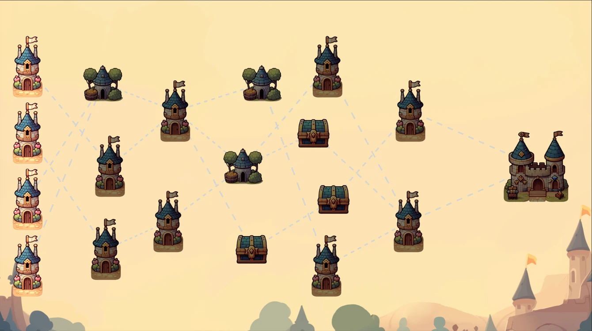
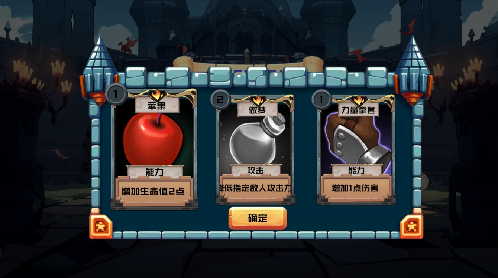
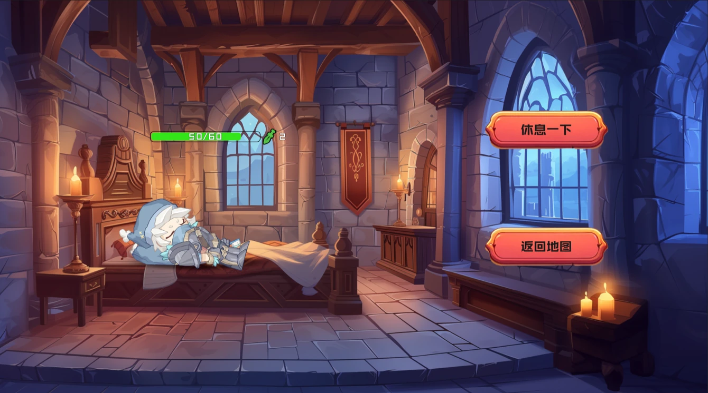
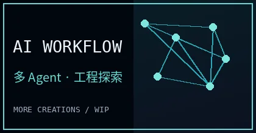

**Unity 游戏开发者 · Gameplay Programmer · Multiplayer Systems**

你好，我是 **White**。喜欢游戏，也喜欢把自己的想法变成能真正运行的作品。  
这里是我的**游戏与技术陈列室**：记录独立游戏创作、客户端开发和联机技术实践。

<a href="https://github.com/shaobaichen">GitHub</a>　·　<a href="mailto:2767955151@qq.com">2767955151@qq.com</a>

---

## 🎮 Featured Works · 我的作品陈列室

每个项目都有属于自己的世界。公开项目可以进入仓库查看源码与技术实现；尚未公开的项目则先展示开发方向与进展。

### 01 · 《魇》 YAN: The Forgotten Mask

**中式民俗志怪题材 · 第三人称动作 RPG**　`Unity 6` `C#` `URP` `WIP / 开发中`

《魇》是我正在制作的独立游戏与毕业设计，灵感来自中国傩文化、传统民俗及志怪想象。当前主要推进无归村关卡、角色与场景表现、交互界面以及动作玩法原型。

展柜背景为氛围设计图；其中的主菜单、角色场景与行囊画面来自实际 Unity 开发截图，经过裁切处理。目前项目仍在持续制作中，不代表全部玩法已经完成。

📷 再看一张《魇》的开发中画面：无归村休整点

包含尚未替换的占位模型，展示的是开发过程而非最终版本。

> 《魇》目前尚未公开完整源码。后续会在这里补充独立项目展示页、实机演示与开发记录。

 

### 02 · Lockstep Arena

**1v1 帧同步局域网竞技场**　`Unity 6` `C#` `TCP` `Protobuf` `Client Prediction` `Rollback`

一个可游玩的多人联机技术项目。它将战斗规则从 Unity 表现层独立出来，由服务器发布完整权威输入帧；客户端支持有界预测、Dirty Frame 检测和状态回滚，并通过 StateDigest 与权威帧回放验证对局一致性。

  
  

左：状态诊断 / Diagnostics　·　右：权威帧回放 / Authoritative Replay。上方均为正式 Windows Player 版本的真实截图；科技展签为装饰性设计图。

**🔗 [查看 LockstepArena_Portfolio：正式源码、架构说明与运行指南 →](https://github.com/shaobaichen/LockstepArena_Portfolio)**

 

### 03 · MOBA Client Framework · 社交大厅客户端框架

**Unity 社交大厅与客户端基础框架 Demo**　`Unity 6` `C# / xLua` `TCP` `Protobuf` `AssetBundle` `Public Source / 完整工程私有`

这个项目聚焦游戏的**客户端大厅与社交体验**：注册登录、玩家信息展示、好友申请与在线状态、私聊和消息推送；底层按 UI、Lua 业务、网络与资源管理分层，并使用 MockServer 验证客户端交互链路。

技术侧重点是 **C# 与 xLua 协作、TCP 长连接及 Protobuf 消息路由、AssetBundle 资源管理和版本更新流程**。它是客户端系统实践，不是已经完成英雄战斗、匹配或完整 MOBA 对局的游戏。

**🔗 [查看 MOBA-Client-Framework-Source：公开源码、模块结构与技术说明 →](https://github.com/shaobaichen/MOBA-Client-Framework-Source)**

展示图以原 Unity 工程真实运行截图为基础，经过裁切与作品集排版；右侧热更新部分为代码流程示意，并非实机更新成功截图。游戏相关美术素材版权属于各自权利人。公开仓库仅提供整理后的源码，不包含完整 Unity 工程、第三方插件或美术资源。

---

 

### 04 · Roguelike Card Game · 卡牌构筑与随机地图

**Unity Roguelike 卡牌构筑玩法原型**　`Unity` `C#` `ScriptableObject` `UGUI` `DOTween` `事件系统` `Public Source`

基于 Unity 制作的卡牌构筑与分支路线探索原型。已编写**抽牌与弃牌管理、卡牌拖拽和效果组合、回合战斗、敌人行动、随机分支地图、房间交互与战斗后奖励**等模块，重点实践以 ScriptableObject 配置玩法数据、以多态组合卡牌效果，并用事件与管理器组织游戏流程。

  
  

左：随机路线与房间节点 · 右：战斗后的卡牌奖励。以上均来自原 Unity 工程截图。

📷 查看休息房间界面

**🔗 [查看 Roguelike-CardGame-Source：65 个 C# 脚本、模块结构与中文技术说明 →](https://github.com/shaobaichen/Roguelike-CardGame-Source)**

图片仅裁去 Unity 编辑器外框，并进行等比例缩放和压缩；未改写游戏中的角色、数值或卡牌文案。此作品为学习与实践阶段的玩法原型，不等于已发行游戏。图片中第三方美术素材的版权仍归原权利人；公开仓库仅包含代码快照，并非可直接运行的完整 Unity 工程。

---

## 🗂️ More Creations · 更多创作

**AI 开发探索** · `Agent` `工作流` `开发工具`

持续研究中 · 后续整理独立技术展示

## 🛠️ Tech Stack · 技术与工具

`Unity` · `C#` · `Lua / xLua` · `TCP / Protobuf` · `UGUI` · `AssetBundle` · `Git` · `C++ / LeetCode`

---

**Make games. Learn systems. Keep creating.**

📬 **[2767955151@qq.com](mailto:2767955151@qq.com)**　·　**[github.com/shaobaichen](https://github.com/shaobaichen)**

